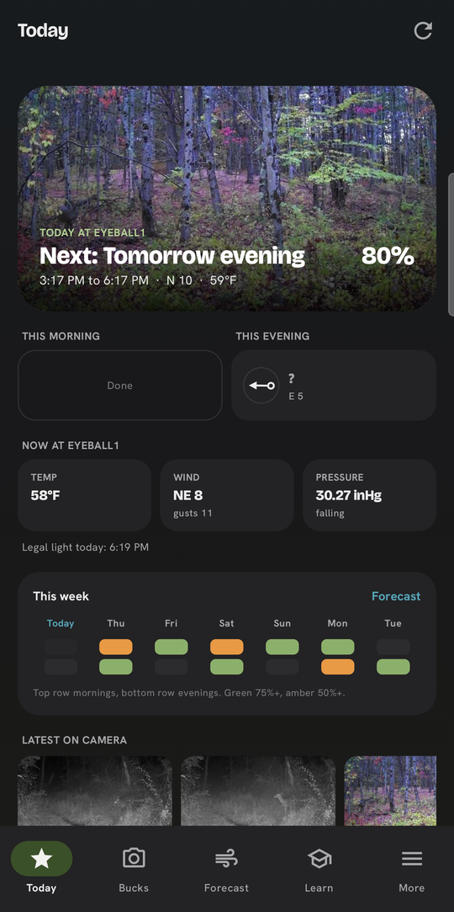
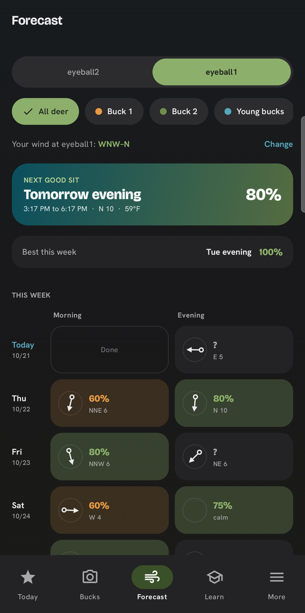
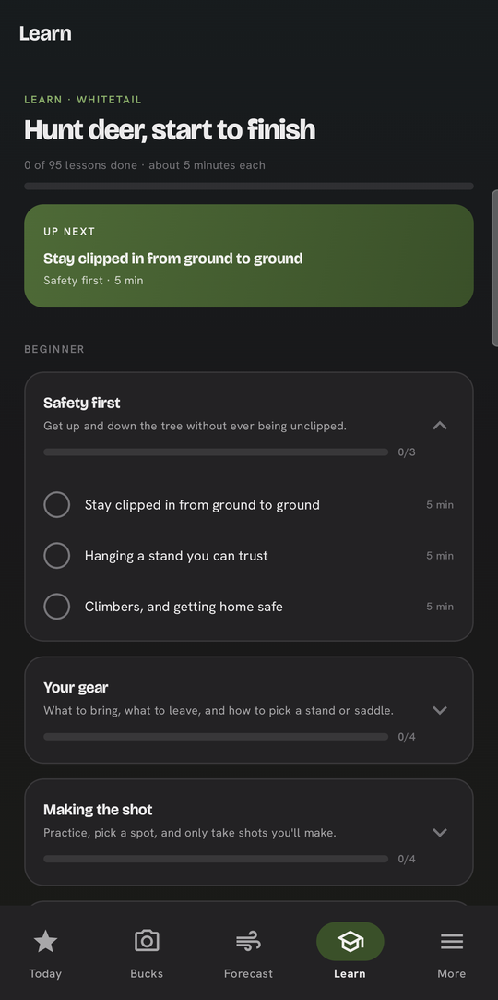

# Kairos

A hunting app for Android and Galaxy Watch that answers one question: **when and where should I sit?**

Kairos reads live weather for your stands and your own trail-camera photos, then lays out the best sits for the week:
which stand, which hours, and whether the wind is right for that stand. Every recommendation comes from cited research or
expert consensus. When the evidence isn't there, the app says "unknown" instead of guessing.

<p>
  
  
  
</p>

## What it does

- **Today** shows today's best sit at your stand, with conditions and legal shooting light.
- **Forecast** lays out the week as a calendar, numbers the three best sits, and draws the wind at the stand for each one.
- **Bucks** imports trail-camera photos, reads the date and temperature off each photo's info strip, removes duplicates,
  and learns each buck's pattern: which camera, what time, and on which wind.
- **Wind** animates the live wind over the map, with a 7-day history and terrain-adjusted wind near your stands.
- **Learn** has 95 short lessons, from beginner to advanced.
- **Galaxy Watch** shows the score at a glance from a Wear OS tile.

## The hard part: expert advice contradicts itself

Hunting advice on YouTube is everywhere and often conflicts. Kairos treats it as data:

1. AI agents extracted **671 rules** from **75 expert videos**. Each rule is written as conditions → action → why, with
   its source.
2. Those rules were merged into **434 consensus entries**, each weighted by how many *different* people teach it. **112
   places** where hunters and measured research disagree are flagged, so the app can say which is which.
3. A schema validator checks every rule before it reaches the app.

Weather scoring follows the same rule. Each factor's weight comes from published studies, and solunar folklore gets no
weight where the research doesn't support it.

## Built with

Kotlin and Jetpack Compose (phone), Wear OS (watch), and a shared Kotlin engine with unit tests. MapLibre for maps,
ML Kit for on-device text reading, and Python tools for the research pipeline. Weather comes from free sources:
[Open-Meteo](https://open-meteo.com) and the [National Weather Service](https://www.weather.gov/documentation/services-web-api).
Everything is scored on the phone, and the last forecast is cached for use with no signal.

## Build

Requires JDK 17+ and the Android SDK.

```
./gradlew :engine:testDebugUnitTest   # engine tests
./gradlew :app:assembleDebug          # phone app
./gradlew :wear:assembleDebug         # watch tile
```

Research notes, transcripts, and personal hunting data are kept out of this repository.
